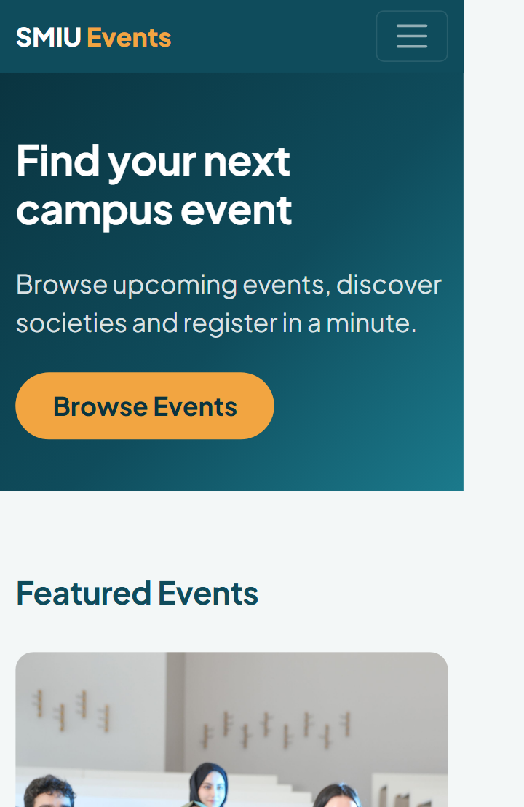

# SMIU Events Portal - Alpha

The SMIU Events Portal is a front-end website built for the SMIU Student Affairs Office. Students can browse upcoming events, explore societies and register for events. It has 6 responsive pages and is built with HTML, CSS and Bootstrap 5.3.3.

## Group Members
| Name | Roll No. | GitHub Username | Pages Built |
|---|---|---|---|
| Member 1 (Team Lead) | | | Repo setup, navbar/footer, index.html |
| Member 2 | | | events.html, event-details.html |
| Ibrahim | Roll No. | @IBRAHIM_USERNAME | societies.html, register.html, contact.html, README |

## Screenshots
- Home page (phone):

  

- Home page (desktop):

  
  
## How to Run
1. Clone the repo.
2. Open `index.html` in a browser (internet is needed for Bootstrap CDN).

## Teamwork Problem and Solution
(One paragraph: describe the `style.css` merge conflict and how you solved it.)
